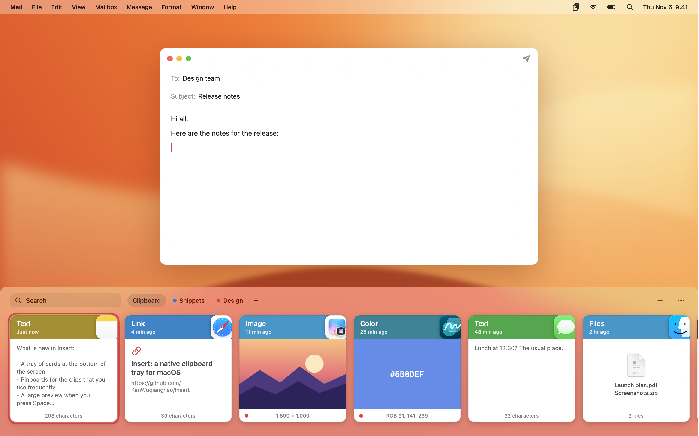
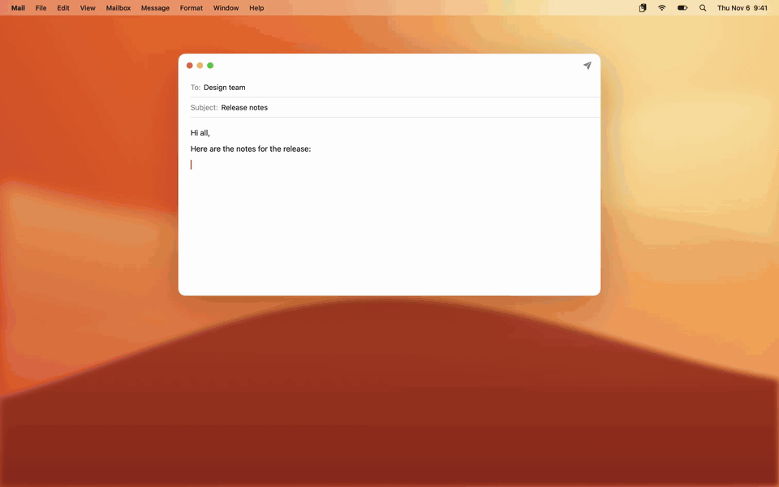
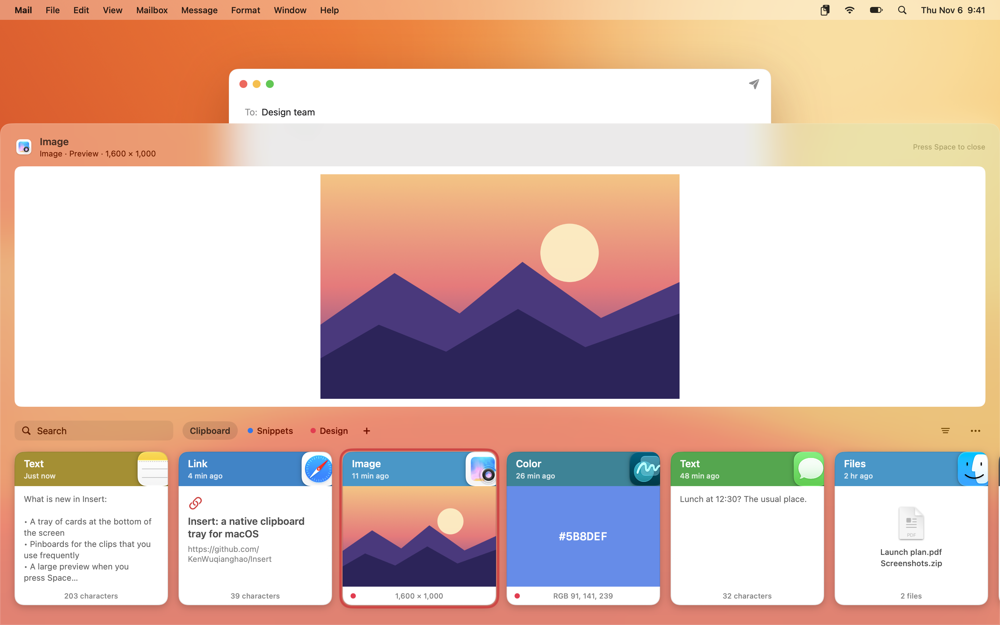
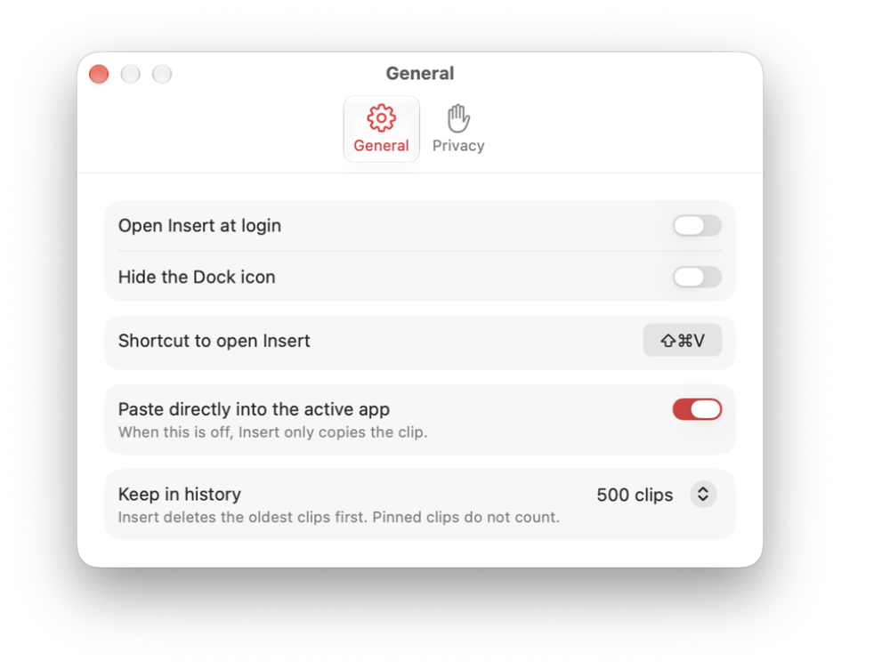

# Insert



**Insert** is a native clipboard tray for macOS. Press the shortcut and the tray comes up from the bottom of the screen. Select a clip and Insert pastes it into the app that you use.

Product page: https://insert-app.vercel.app

Insert has no account and no cloud sync. All data stays on your Mac.

## Demo

[](docs/assets/insert-demo.mp4)

Click the demo to open the [full-quality video](docs/assets/insert-demo.mp4). The demo shows these steps:

1. Press `Command+Shift+V` to open the tray.
2. Press the arrow keys to move the selection. Press `Space` to see a large preview.
3. Type to search.
4. Press `Tab` to go to the next pinboard.
5. Hold `Command`, then press `1` to paste the first card into the email.

## Highlights

- A full-width tray at the bottom of the screen, inspired by Paste.
- Cards show the source app, the type, the time, and a preview of the content.
- Press `Enter` to paste the selected clip into the active app.
- Press `Shift+Enter` to paste the clip as plain text.
- Type to search. Use the filter to show one type of clip.
- Pinboards keep clips that you use frequently. The history limit does not delete pinned clips.
- Press `Space` to see a large preview of a clip.
- Hold `Command` to show the numbers 1 to 9 on the cards. Press `Command+1` to `Command+9` to paste that card.
- Insert skips items that an app marks as concealed or transient, for example passwords from a password manager.
- You can pause capture, and you can ignore the apps that you select.
- The Settings window has two tabs. **General** has launch at login, the Dock icon, the global shortcut, direct paste, and the history limit. **Privacy** has the ignored apps, the capture pause, and the command to clear the history.
- Insert stores text, links, files, images, PDFs, rich text, colors, and common media types.





## Download

Download the latest drag-to-install disk image from [GitHub Releases](https://github.com/KenWuqianghao/Insert/releases/latest) and open `Insert-Installer.dmg`. Drag **Insert** into **Applications**.

Local builds are written to:

```sh
build/Insert-Installer.dmg
```

## First Open

Insert is not notarized by Apple, so macOS blocks it the first time that you open it. Open **System Settings** > **Privacy & Security** and click **Open Anyway**. Updates install through Sparkle and do not show this prompt again.

## Release

`Tools/release.sh` publishes a new version:

```sh
Tools/release.sh 1.2.0 --dry-run
Tools/release.sh 1.2.0
```

The script does these steps:

1. Sets `CFBundleShortVersionString` to the version and increases `CFBundleVersion` by 1 in `Info.plist`.
2. Runs `make dmg`.
3. Signs the DMG with Sparkle's `sign_update`.
4. Creates the GitHub release `v1.2.0` with `Insert-Installer.dmg` on this repository.
5. Writes the appcast to `$APPCAST`. The default is `../insert-site/appcast.xml`.

`--dry-run` does steps 1 to 3, prints the appcast, and puts `Info.plist` back. It does not create the release.

After a release, commit `Info.plist` here, then commit and deploy `appcast.xml` in insert-site.

The Sparkle signing key is in the login Keychain, in the item `https://sparkle-project.org` (account `ed25519`). Back up this item. If you lose it, the installed copies of Insert cannot accept updates. To export a backup file, run `vendor/Sparkle-2.10.1/bin/generate_keys -x <file>`. Keep the file in a safe place. The first time `sign_update` runs, the Keychain asks for permission. Click **Always Allow**.

`make notarize` notarizes and staples the DMG. It needs a Developer ID certificate and a `notarytool` profile, so it is for later. Run it before Sparkle signs the DMG.

## Controls

| Action | Shortcut |
| --- | --- |
| Open or close Insert | Global shortcut, default `Command+Shift+V` |
| Move the selection | Arrow keys |
| Extend the selection | `Shift` + arrow keys |
| Select all clips | `Command+A` |
| Paste the selected clip | `Enter` or double-click |
| Paste as plain text | `Shift+Enter` |
| Copy without paste | `Command+C` |
| Paste card 1 to 9 | `Command+1` to `Command+9` |
| Preview | `Space` (when the search field is empty) |
| Delete the selection | `Backspace` or `Delete` (when the search field is empty), or `Command+Backspace` |
| Go to the next or previous pinboard | `Tab` / `Shift+Tab`, or `Command+]` / `Command+[` |
| Search | Type in the tray |
| Close the preview, clear the search, or close the tray | `Esc` |
| Open Settings | `Command+,` |

Right-click a card to pin, rename, preview, or delete the clip. Right-click a pinboard tab to rename it, change its color, or delete it.

## Accessibility Permission

Insert pastes with a simulated `Command+V`. macOS permits this only for apps that have the Accessibility permission.

1. Open Insert. If the permission is missing, the tray shows a notice.
2. Click **Allow…** in the notice.
3. Turn on **Insert** in System Settings > Privacy & Security > Accessibility.

Without the permission, Insert copies the clip and you press `Command+V`. To use copy only, turn off **Paste directly into the active app** in Settings.

A local build has an ad hoc signature. macOS can ask for the permission again after each new build.

## Build From Source

```sh
make run
```

The app bundle is created at `build/Insert.app`.

To build a second copy with its own bundle id, storage folder, and settings:

```sh
make dev
```

This creates `build/InsertDev.app`. Use it to test a build while an installed Insert runs.

To make the screenshots and the demo video in this README again:

```sh
make marketing-assets
```

This command records the real tray views with sample clips. It does not read your clipboard. It needs `ffmpeg` and the Screen Recording permission for your terminal. Keep the screen unlocked while it runs. If the recording loses frames, the command records the demo again. It makes a maximum of three takes.

To build the installer:

```sh
make dmg
```

## Windows

The Windows-specific repo is available at:

https://github.com/KenWuqianghao/insert-windows

The mirrored source under [`windows/Insert.Windows.sln`](./windows/Insert.Windows.sln) and [`windows/Insert.Windows`](./windows/Insert.Windows) is a native WinForms port with the same clipboard tray, search, hotkey, and persistent history model.

Build it on Windows with the .NET 8 Windows Desktop workload installed:

```sh
dotnet build windows/Insert.Windows.sln
```

## Storage

Insert keeps its data in a folder that has the name of the bundle id:

```sh
~/Library/Application Support/com.local.Insert/
├── index.json        # clip metadata and pinboards
├── payloads/         # one file for each clip, with the full pasteboard content
└── thumbnails/       # one PNG for each image clip
```

Insert does not store an item that is larger than 50 MB.

Version 0.2 does not read the history from version 0.1. The old file `~/Library/Application Support/Insert/ClipboardHistory.json` stays on disk. Delete it if you do not need it.

Windows startup is stored in the current user's `Run` registry key and is toggled from the tray menu.
